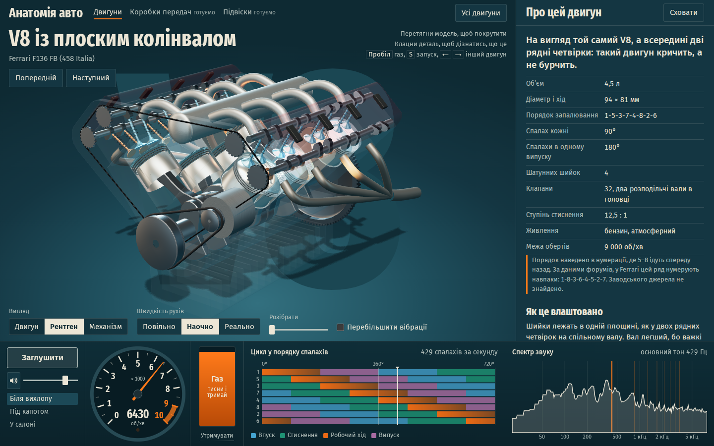

# Анатомія авто

Інтерактивна база знань про будову автомобіля. Перший розділ присвячено двигунам: 25 компоновок у 3D, кожну можна покрутити, завести, погазувати й послухати. Далі в планах коробки передач і підвіски.

**Динамометричний стенд**: кнопка «На стенд» ставить двигун на вихрострумове або гідравлічне гальмо. Гальмо тримає задані оберти або веде розгін із заданим темпом, а криві моменту й потужності малюються наживо в Н·м і к.с., ті самі, що в статті. Видно, як турбіна набирає тиск, скільки моменту йде на розгін маховика і чим двигун під навантаженням звучить інакше, ніж на перегазовці.

**Конструктор двигуна** (`#/designer`) дає зібрати власний двигун десятками параметрів: компоновка, циліндри, колінвал із будь-якими кутами шийок, клапани й фази, наддув, паливо, вихлоп. Потужність, момент, витрата й надійність перераховуються миттєво, а зібраний двигун можна завести і послухати. Посилання зберігає конструкцію, тому нею легко поділитись. Як саме рахується модель, описано в [docs/engine-designer-model.md](docs/engine-designer-model.md).



## Запуск

```sh
npm install
npm run dev        # http://localhost:5173
npm test           # кінематика, динаміка обертів, звук
npm run build      # статичний сайт у dist/
```

Потрібен Node.js 22.18 або новіший.

## Публікація на GitHub Pages

1. Запуш репозиторій на GitHub у гілку `main`.
2. Увімкни Settings → Pages → Source: GitHub Actions.

Робочий процес `.github/workflows/pages.yml` запустить тести, збере сайт і викладе його. Адреси відносні, тому сайт працює на будь-якому шляху, а маршрути тримаються в `#`, тому Pages не потрібні перенаправлення.

## Як це влаштовано

Двигун описано конфігурацією конструктора в `src/data/engines.ts`: порядок запалювання, кути рядів, діаметр, хід, випуск. Усе інше виводиться з цього опису.

| Частина | Файли | Що робить |
|---|---|---|
| Кінематика | `src/engine/kinematics.ts` | Кути шийок колінвала з порядку запалювання, рух поршня, клапани, вібрації, момент. Без рендера й звуку |
| Динаміка | `src/engine/sim.ts`, `loaded-crank.ts` | Стартер, холостий хід, газ, обмежувач обертів, турбіна; під навантаженням момент у Н·м |
| Стенд | `src/engine/dyno-load.ts`, `src/ui/dyno/` | Гальмо, його регулятор і розгін; панель із графіками й замірами |
| Звук | `src/audio/synth.ts`, `dsp.ts`, `worklet.ts` | Синтез в AudioWorklet: імпульси випуску, труби як хвилеводи, впуск, вібрації блока, турбіна |
| 3D | `src/scene/` | Параметричні моделі на Three.js без сторонніх 3D-файлів |
| Інтерфейс | `src/ui/`, `src/main.ts` | Тахометр, педаль, діаграма циклу, спектр, таблиця двигунів, статті |

Кут колінвала живе на аудіопотоці, а картинка читає його звідти, тому в режимах «Повільно» і «Реально» рух і звук збігаються.

### Звук

Записів немає: кожен звук рахується з кута колінвала. Схема спирається на роботи про фізично обґрунтований синтез двигунів: Baldan et al., *Physically informed car engine sound synthesis* (2015), модуль motor із [Sound Design Toolkit](https://sdt.lim.di.unimi.it/docs/API/v2.2-078/group__motor.html) і [Doerfler & Wyse (2026)](https://arxiv.org/abs/2603.09391).

```
випускний клапан відкрився → імпульс → первинна труба → збірник → труба → глушник → зріз → лівий або правий канал
```

Чому хрестовий V8 бурчить, а площинний кричить, у коді не задано окремо. Це випливає з того, які циліндри сходяться в одному колекторі.

Гучність двигунів вирівнює `node scripts/calibrate.ts`. Перевіряти звук без колонок допомагають `node scripts/orders.ts <id> <об/хв> <газ>` (рівень кожного порядку обертів) і `npm run render-audio` (WAV у `.tmp/audio`).

## Обмеження

- Звук синтезовано, це модель, а не запис конкретного двигуна. Перевірено вимірюваннями, але остаточно його оцінює вухо.
- Без стенда двигуни працюють без навантаження, як у нейтралі: коробки передач і ваги авто в моделі ще немає. Часткове навантаження на стенді рахується лінійним наближенням Віллінса.
- Моделі параметричні, вони показують принцип, а не точну копію конкретного двигуна. Спрощено, зокрема, канали VR і W, а турбіни роторних двигунів звучать, але не намальовані.
- Частину цифр не вдалося звірити з першоджерелом. Такі місця позначено в статті.

## Конструктор

| Файл | Що робить |
|---|---|
| `src/designer/design.ts` | Усе, що можна вибрати |
| `src/designer/constraints.ts` | Межі, що залежать від інших параметрів, і `resolveDesign`, який приводить будь-який дизайн до придатного для побудови стану |
| `src/designer/crank.ts` | Таблиця шийок і пошук порядку запалювання з найменшими вібраціями |
| `src/designer/physics.ts` | Модель продуктивності, `evaluate(design)` |
| `src/designer/diagnostics.ts` | Пояснення, що піде не так і чому |
| `src/designer/reliability.ts` | Межі міцності, вирок, зони обертів і знос |
| `src/designer/sensitivity.ts` | Який контрол що змінює, пораховано самою моделлю |
| `src/designer/to-spec.ts` | Перетворює дизайн на звичайний `EngineSpec`, тому 3D і звук працюють без окремих гілок |
| `src/designer/catalogue.ts`, `src/data/engines.ts` | Каталог: кожен двигун є конфігурацією конструктора плюс текст статті |
| `src/ui/designer/` | Панелі, графіки й узгодження всього цього під час руху повзунка |

Сайт двомовний: українська і англійська, правила перекладу й термінологія в `docs/i18n.md`.

Каталог збирається тим самим шляхом, що й двигун відвідувача, тому будь-який його двигун відкривається в конструкторі як точна копія. Перша інженерна зміна вмикає розрахунок за моделлю, а параметри вихлопу лишаються, поки не зміниш їх. `tests/catalog-snapshot.test.ts` стежить, щоб рендер і звук каталогу не змінились випадково.

Перевірити модель на справжніх двигунах можна командою `node scripts/designer-table.ts`.

На кожній сторінці каталогу є список реальних двигунів цієї компоновки (`src/data/engine-variants.ts`), між якими можна перемикатись просто на ходу. Діаметр, хід, стиснення, відсічка, потужність і момент узяті з джерел, наведених у статті двигуна. Фази, клапани, впуск і характер вихлопу оцінені за цими цифрами й описами, а незвірені значення перелічено в самій статті.

Свист турбіни, скид тиску й прострели задаються окремо для кожного мотора (`turboWhine`, `blowoff`, `pops`), бо це властивість конкретного авто, а не турбіни взагалі. Заводські турбомотори зазвичай повертають повітря у впуск, а на скиданні газу перекривають паливо, тому без свідчень про конкретну машину береться тихе значення. У статті написано, чи є такі свідчення. Сам запуск не моделюється: двигун провертається беззвучно і чутний із моменту, коли схопив.

У межах однієї сторінки всі двигуни показано в одному масштабі, а масштаб видно на лінійці, тому менший двигун справді виглядає меншим.

## Як додати двигун

Додай запис у `CATALOGUE` (`src/data/engines.ts`). Якщо порядок запалювання не сходиться з кутами рядів, колінвал вийде нереальним, а тести в `tests/kinematics.test.ts` покажуть розбіжність. Потім запусти `node scripts/calibrate.ts`.

## Як додати новий розділ

Поки реалізовано лише двигуни. Посилання на майбутні розділи стоять у `src/main.ts`, у навігації `.sections`. Сцена, студійне світло й оболонка сторінки не залежать від двигуна, тому їх можна використати для коробок передач і підвісок.
